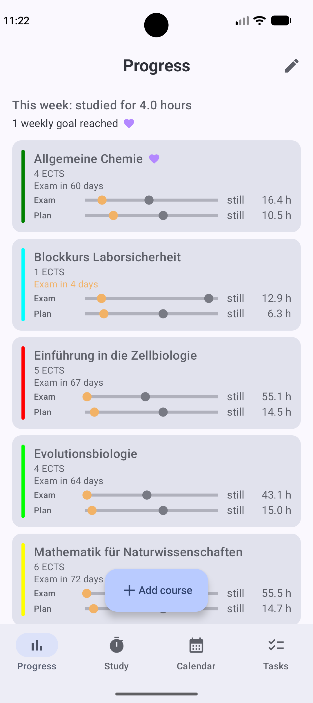
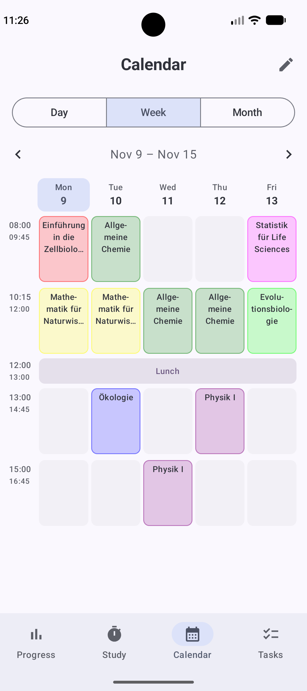
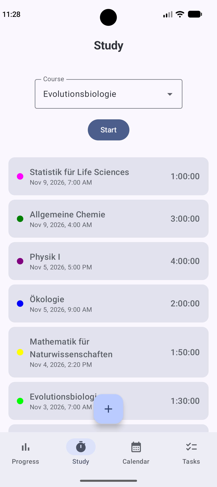
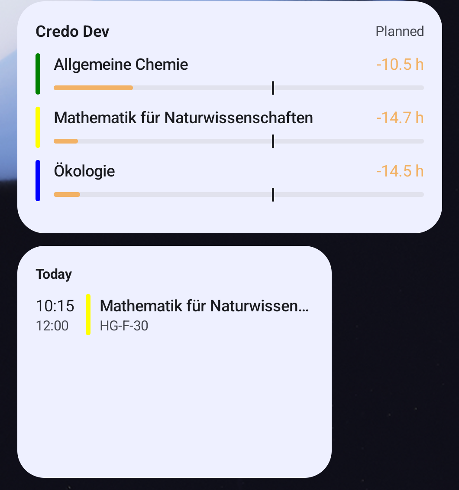
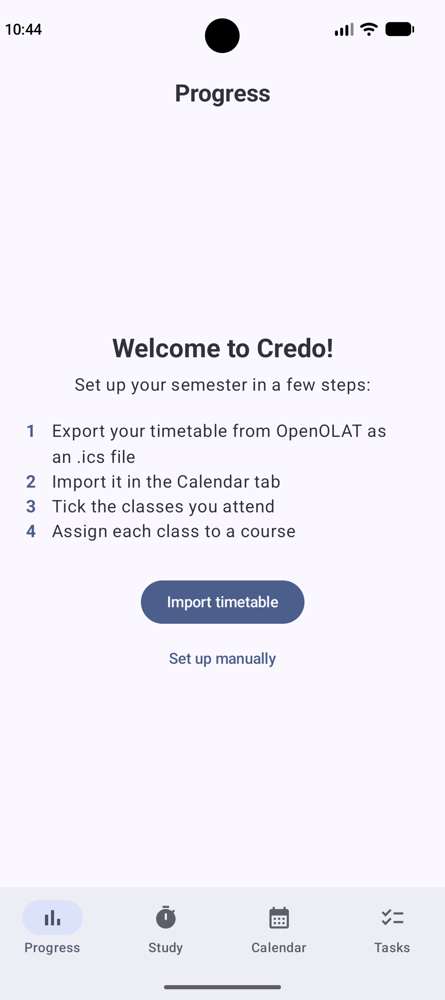
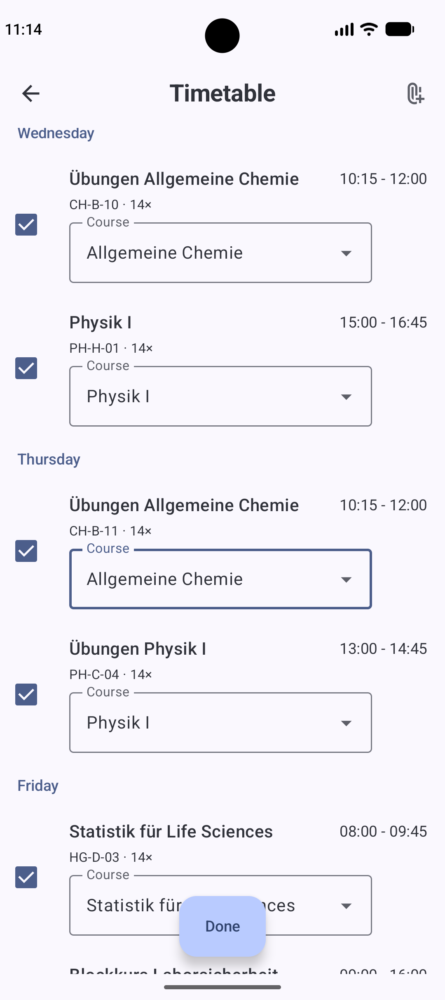
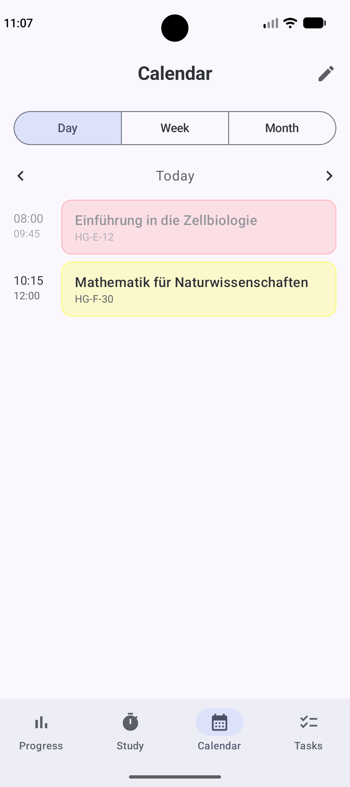
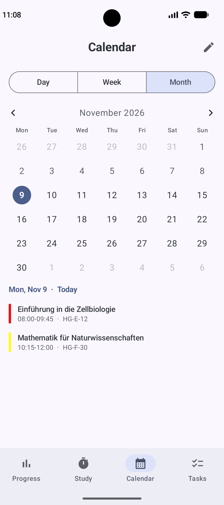

# Credo

A study planner for university students, built for Android with Kotlin and Jetpack Compose.

Credo tracks how many hours you study for each course and compares them with what your ECTS credits actually require. It imports your timetable, shows your lectures in a calendar and puts today's classes and your study progress on the home screen.

  
  
  
  

## Why I built it

I built Credo for two reasons. I want to move from retail into software development, and I needed a real project to learn on. At the same time, my girlfriend had just started her biomedicine degree and couldn't find a single app that tracks study time and compares it with the ECTS workload. So I built one for her.

She told me at the start what she needed, and she's been using it on her phone ever since. Her feedback decides what gets added, improved or taken out. Before I build a new screen, I show her a mockup first, so she can comment on it before any code exists. Working in retail taught me to listen for what a customer actually needs, not just what they ask for. This is the first time I'm in love with my customer, though.

## Features

- **Timetable import.** Import the semester timetable as an `.ics` file (e.g. from OpenOLAT), tick the classes you actually attend and assign each one to a course. Courses can be created right from the import, and the semester dates are detected automatically.
- **Courses based on ECTS.** Each course knows its credits (30 hours per credit), its lecture and lab hours, the lecturer and the exam date.
- **Study tracking.** Track sessions with a timer or enter them by hand.
- **Progress.** For every course, two bars show whether you're on pace for the exam and for your own weekly plan. Weekly goals are marked when you reach them, and exams coming up soon are highlighted.
- **Calendar.** Day, week and month views. The week grid is built from your actual lecture times, adds weekend days only when needed and shows lunch breaks.
- **Two home screen widgets.** One shows the remaining lectures today, the other shows your progress per course.
- **English and German.** The app follows the language of the phone.

More screenshots

  
  
  
  

## Tech stack

- **Kotlin** with **Jetpack Compose** and **Material 3**
- **Room** for the local database, with exported schemas and automatic migrations (currently version 7), so users keep their data through every update
- **Kotlin Coroutines and Flow**: the UI updates automatically when the data changes
- **ViewModels** for the logic behind each screen
- **Navigation 3** with type-safe routes
- **Jetpack Glance** for the home screen widgets
- My own **iCalendar (`.ics`) parser**, with unit tests that include daylight saving time changes
- Minimum Android 8.0 (API 26)

## How it's built

The project started on 8 October 2026. Since then I've worked on it almost every day, and Credo has had 11 releases so far. Each release is a signed APK that is installed over the previous version, and whenever the database changes, the migration is tested before release. The steps are written down in [RELEASING.md](RELEASING.md).

Having been diagnosed with ADHD in 2021, I also saw this project as a test for myself. Usually I lose interest in things quickly and want to start something new. With Credo, I've sat down almost every day for over a month, and it still hasn't gotten boring. The commit history shows that better than I can describe it.

### Learning with AI

I didn't build this alone, and I don't pretend to. I learned with Claude, an AI assistant, as my tutor. It explained new concepts with small examples, gave me hints instead of finished code, and reviewed what I wrote. I wrote the code myself and made the design decisions together with the app's user.

I think working well with AI is a skill in its own right: keeping a build plan, asking precise questions, and checking the answers instead of copying them.

## What's next

- Tasks and exams: assignments with due dates, an exam countdown, and both shown in the calendar (in progress)
- Reminders before deadlines and exams
- Settings, and export and import of all data
- Sync between phone and tablet

## Try it

1. Clone the repository and open it in Android Studio.
2. Run the `app` configuration on an emulator or a phone.
3. To see it with data, import [`demo_semester.ics`](app/src/test/resources/demo_semester.ics). It's a fictional timetable that is also used by the tests.
